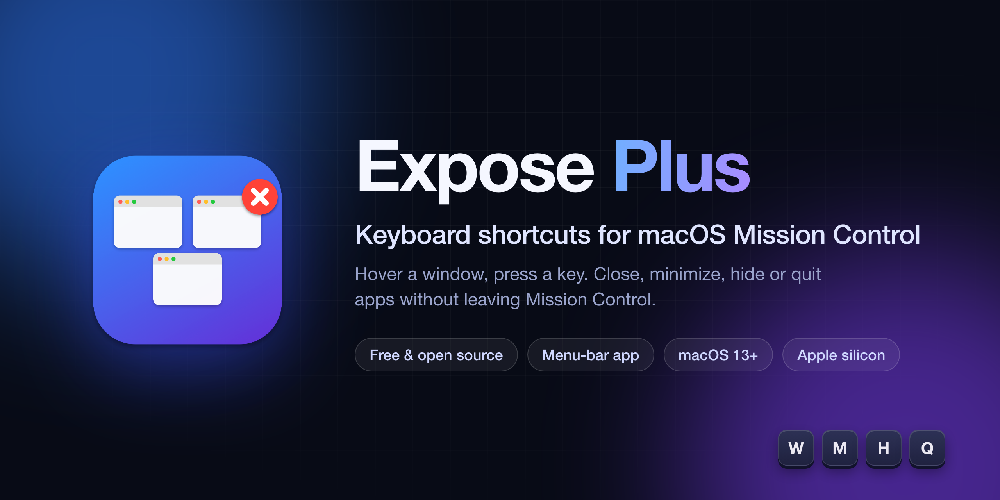
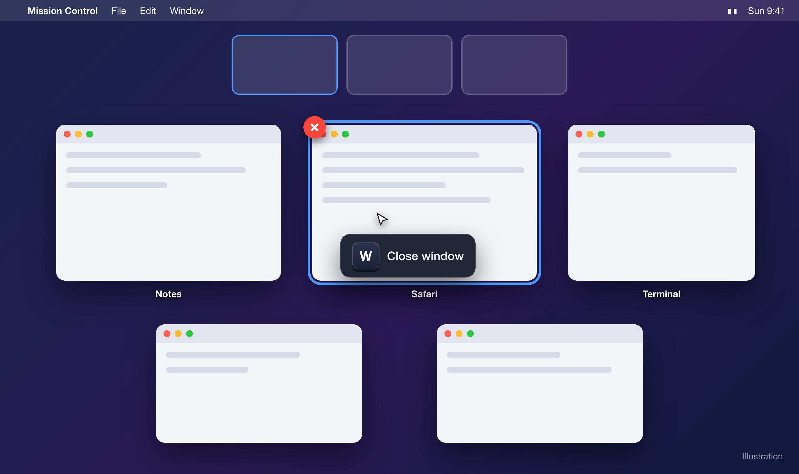
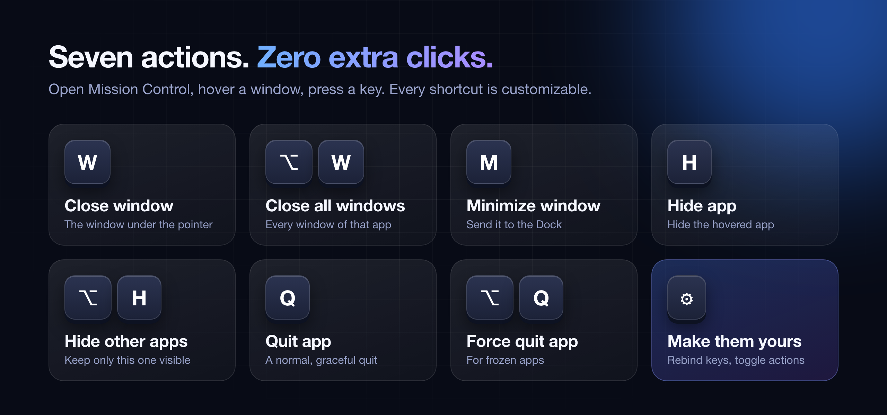
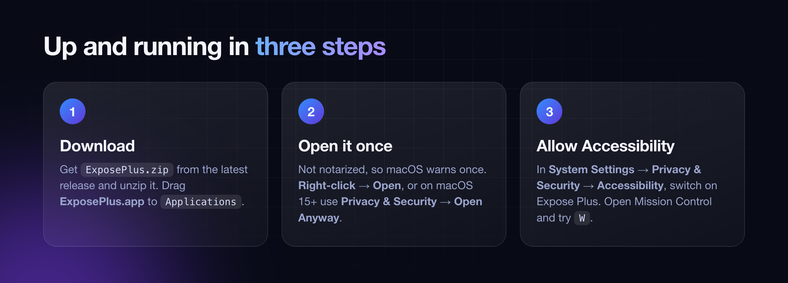

<div align="center">



<br>

[](https://github.com/SmallToolsStudio/ExposePlus/releases/latest)
[](https://github.com/SmallToolsStudio/ExposePlus/releases)
[](#requirements)
[](Package.swift)
[](LICENSE)

**[Download](https://github.com/SmallToolsStudio/ExposePlus/releases/latest/download/ExposePlus.zip)** · [How to install](#install) · [Shortcuts](#keyboard-shortcuts) · [FAQ](#faq) · [Build from source](#build-from-source)

</div>

---

## What is Expose Plus?

**Expose Plus is a free, open-source menu-bar app that adds keyboard shortcuts to macOS Mission Control (Exposé).**

Open Mission Control, hover a window, and press a key to **close the window, minimize it, hide the app, quit it or force quit it**, without leaving Mission Control and without reaching for the tiny red button. It's the missing "clean up my desktop" layer for people with too many windows open.

- Close a single window with <kbd>W</kbd>, or every window of an app with <kbd>⌥</kbd><kbd>W</kbd>
- Minimize with <kbd>M</kbd>, hide with <kbd>H</kbd>, quit with <kbd>Q</kbd>, force quit with <kbd>⌥</kbd><kbd>Q</kbd>
- A small **✕ button** appears on the hovered window for mouse users
- **Every shortcut is customizable** in Settings
- Lives in the **menu bar**, no Dock icon, tiny and fast, no background clutter
- Written in **Swift** with AppKit and the macOS Accessibility API. No dependencies, no network access, no analytics

<div align="center">

<br><sub>Illustration: hover a window in Mission Control, press <b>W</b>, and it closes.</sub>
</div>

## Why use it?

Mission Control is great for *seeing* all your windows and terrible for *tidying* them. Closing windows means aiming at a small button on every thumbnail, and quitting an app means leaving Mission Control, switching to it and pressing ⌘Q. If you keep dozens of Safari, Finder, Terminal or Xcode windows open, Expose Plus turns that into a single keypress.

Useful if you are looking for: *close windows in Mission Control · quit apps from Mission Control · keyboard shortcuts for Mission Control · Exposé shortcuts · macOS window management · hide or quit apps with one key · declutter desktop on Mac.*

## Keyboard shortcuts

<div align="center">

</div>

Open Mission Control, **hover** the window you want to act on, then press:

| Key | Action | What it does |
|:---:|---|---|
| <kbd>W</kbd> | Close window | Closes the window under the pointer |
| <kbd>⌥</kbd> <kbd>W</kbd> | Close all windows | Closes every window of that app |
| <kbd>M</kbd> | Minimize window | Sends the window to the Dock |
| <kbd>H</kbd> | Hide app | Hides the hovered app |
| <kbd>⌥</kbd> <kbd>H</kbd> | Hide other apps | Hides everything except the hovered app |
| <kbd>Q</kbd> | Quit app | Quits the hovered app normally |
| <kbd>⌥</kbd> <kbd>Q</kbd> | Force quit app | Force quits an unresponsive app |

These are the defaults. Open **menu-bar icon → Settings…** to:

- rebind any action to any key with any mix of <kbd>⌃</kbd><kbd>⌥</kbd><kbd>⇧</kbd><kbd>⌘</kbd>
- add an optional **alternate** shortcut per action
- switch individual actions on or off
- show or hide the on-screen ✕ button
- reset everything to the defaults

The menu also has **Launch at Login**, **About** and **Show Log**.

## Requirements

- **macOS 13 Ventura or later**
- **Apple silicon Mac** (M1 or newer) for the prebuilt download. On an Intel Mac, [build from source](#build-from-source); it is one command
- **Accessibility permission**, which the app needs to see and act on windows (see below)

## Install

<div align="center">

</div>

### 1. Download

Grab **[ExposePlus.zip](https://github.com/SmallToolsStudio/ExposePlus/releases/latest/download/ExposePlus.zip)** from the [latest release](https://github.com/SmallToolsStudio/ExposePlus/releases/latest), double-click it to unzip, and drag **ExposePlus.app** into your **Applications** folder.

### 2. Open it for the first time (the app is not notarized)

Expose Plus is a free hobby project and is **not signed with a paid Apple Developer ID or notarized by Apple**. It is only ad-hoc signed, so on first launch macOS Gatekeeper will say it can't verify the app. That is expected and does not mean the app is broken. You can read every line of the source in this repository.

Choose **one** of these:

**macOS 14 Sonoma or earlier:** right-click (or Control-click) **ExposePlus.app** → **Open** → **Open**.

**macOS 15 Sequoia or later:**
1. Double-click the app once and dismiss the warning.
2. Open **System Settings → Privacy & Security**.
3. Scroll to **Security**, click **Open Anyway** next to *"ExposePlus" was blocked*, and confirm.

**Or use Terminal** (works on every version) to clear the download quarantine flag:

```bash
xattr -dr com.apple.quarantine /Applications/ExposePlus.app
open /Applications/ExposePlus.app
```

You only need to do this once.

### 3. Allow Accessibility

Expose Plus reads the window layout of Mission Control and closes, minimizes or hides windows through the macOS Accessibility API, so it needs your permission:

1. Open **System Settings → Privacy & Security → Accessibility**.
2. Switch **ExposePlus** on (click **+** and add it from Applications if it isn't listed).
3. If macOS also asks for **Input Monitoring**, allow that too. It is used to detect your shortcut keys while Mission Control is open.
4. If shortcuts don't react right away, quit Expose Plus from its menu-bar icon and open it again.

That's it. A small icon appears in your menu bar. Open Mission Control (<kbd>F3</kbd>, <kbd>⌃</kbd><kbd>↑</kbd> or a trackpad swipe), hover a window and press <kbd>W</kbd>.

## Privacy and safety

- Runs **entirely on your Mac**: no network connections of its own, no accounts, no analytics, no telemetry (the About window only has an optional [Ko-fi](https://ko-fi.com/smalltoolsstudio) link that opens in your browser)
- Only acts on a window while **Mission Control is open** and you press one of your shortcuts
- Small, readable code, MIT licensed. Audit it, build it yourself, or change it
- Uses the Accessibility permission *only* to find and control windows

## FAQ

**Why does macOS say the app can't be verified?**
Notarization requires a paid Apple Developer membership. This is a free side project, so the app isn't notarized. Follow [step 2](#2-open-it-for-the-first-time-the-app-is-not-notarized) once, or build it yourself from source.

**Is it safe?**
It is open source and has no network code. The prebuilt app in Releases is built from this repository's source. If you'd rather not trust a binary, [build it yourself](#build-from-source).

**Nothing happens when I press a key.**
Check that Expose Plus is switched on under **Accessibility** (and **Input Monitoring** if asked), then quit and reopen it. Make sure you are *hovering a window* in Mission Control, and that the action isn't switched off in **Settings…**.

**It stopped working after a macOS update.**
Mission Control's internals can change between macOS versions, and Expose Plus finds windows by reading the Dock's accessibility tree. See [Troubleshooting](#troubleshooting) and please [open an issue](https://github.com/SmallToolsStudio/ExposePlus/issues).

**Does it work on Intel Macs?**
The prebuilt download is Apple silicon only. On Intel, [build from source](#build-from-source).

**Can I change the shortcuts?**
Yes. **Menu-bar icon → Settings…**

**Are windows on other Spaces supported?**
Mostly. Windows on other Spaces may not be closable through the Accessibility API, and windows with empty titles can't always be matched to a real window.

**How do I uninstall it?**
Quit it from the menu-bar icon, delete **ExposePlus.app** from Applications, and remove it from **Privacy & Security → Accessibility**.

## Build from source

You need the Swift toolchain (Xcode or the Command Line Tools: `xcode-select --install`).

```bash
git clone https://github.com/SmallToolsStudio/ExposePlus.git
cd ExposePlus
./Scripts/build_app.sh
open build/ExposePlus.app
```

The script builds a release binary, assembles `build/ExposePlus.app` and ad-hoc signs it. Building on an Intel Mac produces an Intel app.

<details>
<summary><b>Project layout</b></summary>

```
Sources/ExposePlusCore/   shortcut model, close-button logic (no UI dependencies)
Sources/ExposePlus/       app: menu bar, Mission Control hit-testing, hotkeys, settings
Resources/                Info.plist, app icon, menu-bar icon
Scripts/build_app.sh      builds and signs the .app
Scripts/make_icon.swift   regenerates the app and menu-bar icons
assets/                   README images and logo
```

Regenerate the icons with `swift Scripts/make_icon.swift <outdir>` followed by `iconutil -c icns`.
</details>

## Troubleshooting

Hit-testing reads the Dock's accessibility tree while Mission Control is open. If it stops finding windows on a new macOS version, run this in Terminal, then open Mission Control within 5 seconds:

```bash
/Applications/ExposePlus.app/Contents/MacOS/ExposePlus --dump-mc
```

Include the output when you [open an issue](https://github.com/SmallToolsStudio/ExposePlus/issues), or adjust `Sources/ExposePlus/MissionControl.swift` yourself. **Show Log** in the menu-bar icon also helps when reporting a bug.

## Contributing

Bug reports, ideas and pull requests are welcome. For bigger changes, please open an issue first so we can talk it through. Fork the repository, create a branch, and open a pull request.

## License

Released under the [MIT License](LICENSE). Free to use, modify and share.

<div align="center">
<sub>Made with care by <a href="https://github.com/SmallToolsStudio">Small Tools Studio</a>. If Expose Plus saves you clicks, a ⭐ on this repository is appreciated.</sub>
</div>
